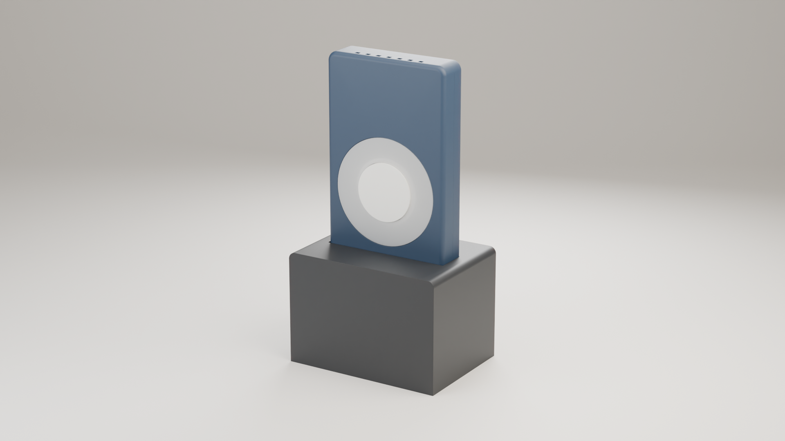
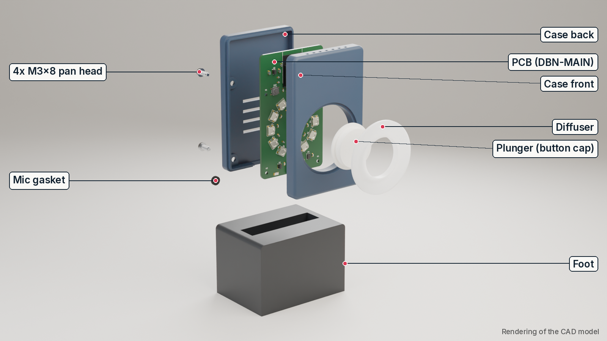
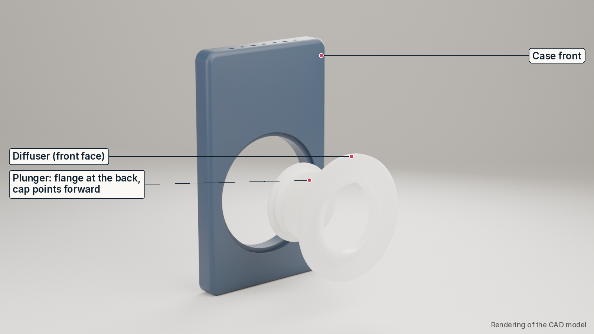
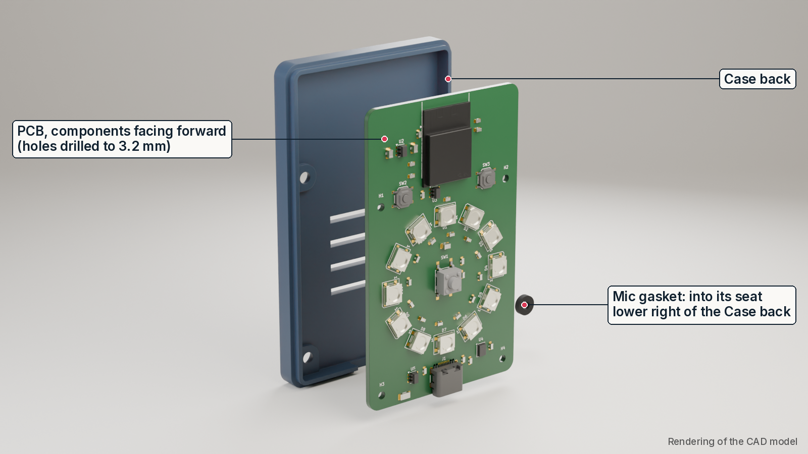
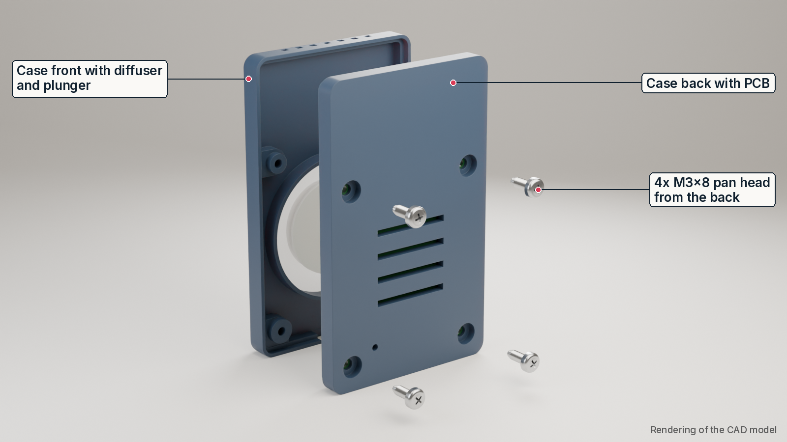
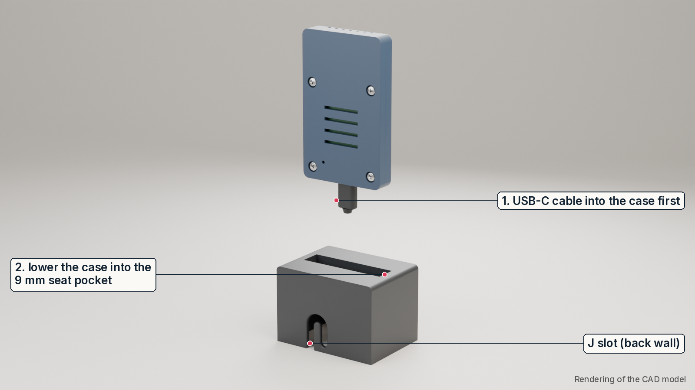
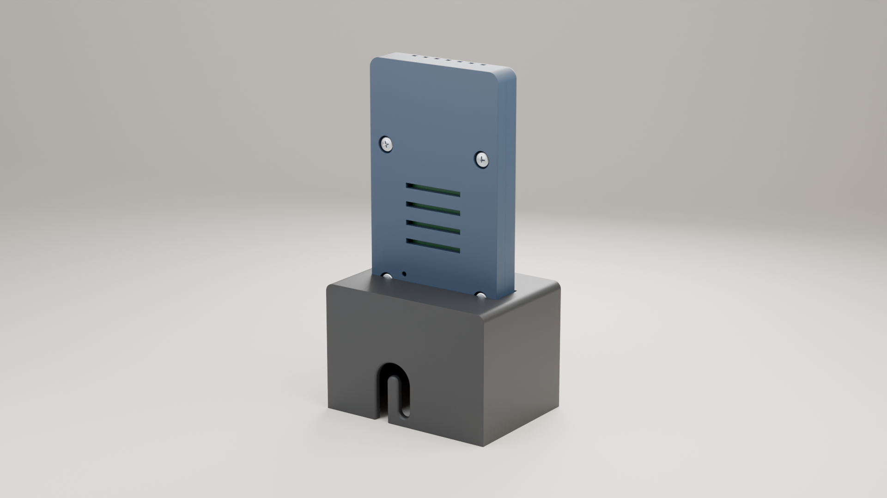
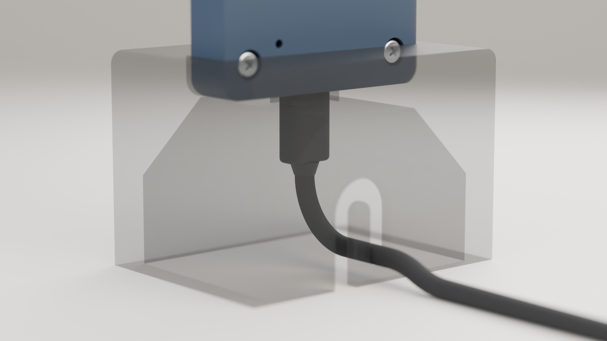

# Doorbell notifier: build guide (v1.3)

A small light that flashes when your doorbell rings. One unit (the **sender**) sits near the doorbell and listens for its sound; one or more units (the **receivers**) sit elsewhere in the home and flash their LED ring when the sender hears the bell. The radio link is ESP-NOW, so no Wi-Fi network or app is needed.

This guide is for makers who rebuild the device from the open-source repository. All paths are relative to the repository root.



*Rendering of the CAD model, not a photograph. Colours are a render choice, not a material requirement.*

**Contents**

1. What you get
2. Parts and tools
3. PCB
4. Printing the parts
5. Assembly
6. Firmware, role and doorbell training
7. Testing and troubleshooting
8. Known limitations

---

## 1. What you get

- **Sender and receiver are the same hardware.** Every unit has the same PCB, case and Foot. The role is set in firmware and saved on the device (NVS), see section 6.3.
- **Sender:** a MEMS microphone listens for your doorbell. The sound is learned on the device (training, section 6.5); no cloud and no recording leaves the device. When it hears the bell, it broadcasts a ring message. On detection it plays the same full-ring alert as the receivers (all 12 LEDs, 15 s); when idle only the status LED (D1) blips.
- **Receiver:** flashes its 12-LED ring for 15 s when the paired sender reports a ring. The centre button mutes it.
- **A set** is 1 sender plus 1 or more receivers (the firmware is documented for up to 5 receivers per sender).
- **Power:** 5 V over USB-C from a USB wall plug. No battery.
- **Size:** case 55.8 x 13.2 x 91.5 mm; in the Foot the device stands about 132 mm tall on a 70 x 51 mm footprint.

| Part | What it is |
|---|---|
| PCB DBN-MAIN rev A | ESP32-S3 module, ICS-43434 microphone, 12x WS2812B-V6 RGB LEDs in a ring, USB-C, 3 buttons (USER, BOOT, RESET) |
| Case back | Holds the PCB, the mic gasket and the 4 screw heads |
| Case front | Front cover with the LED window and 4 screw posts |
| Diffuser | White ring in front of the LEDs; it also guides the button plunger |
| Plunger | Button cap that presses the USER button (SW1) through the diffuser |
| Mic gasket | Small foam ring that seals the microphone port against the case |
| Foot | Stand. The case sits in a 9 mm deep pocket; the USB-C cable locks into a J slot in the back wall |



*Exploded view: rendering of the CAD model.*

---

## 2. Parts and tools

### 2.1 Bill of materials

Two BOM files are in the repository:

- **`docs/bom/bom-product.csv`**: the whole device, one line per item. The populated PCB is a single item; the list also has the printed parts, the mic gasket, the 4 screws and (optional) the USB-C cable and USB wall plug.
- **`docs/bom/bom-costs.csv`**: the PCB component list: every component on the board (for ordering it assembled) with manufacturer part numbers, LCSC numbers and quantities.

Per device you need:

| Qty | Item | Notes |
|---|---|---|
| 1 | DBN-MAIN PCB, assembled | Order from the fab package (section 3). LEDs D1-D12 are WS2812B-V6 (LCSC C52917433). |
| 1 each | Case back, Case front, Diffuser, Plunger, Foot | 3D printed (section 4). About 143 g of PLA per device (solid-model upper bound). |
| 1 | Mic gasket | Foam or TPU, 2 mm thick, OD 6 / ID 2.5 mm. Cut from sheet, or print `mechanics/exports/doorbell-case_Mic_gasket.stl` in TPU. |
| 4 | Screw M3x8, pan head, thread-forming for plastic | Head **max. Ø6.0 x 2.4 mm** (ISO 7045 or DIN 7985 size). A bigger head does not fit the counterbore. |
| 1 | USB-C cable | Must fit the case and the Foot, see "Choosing the USB-C cable" below. |
| 1 | USB wall plug, 5 V | At least 1.5 A recommended (LED ring up to 600 mA plus radio peaks). |
| | Glue | 2-3 drops to hold the diffuser in the Case front (CA glue or a plastic glue that works on PLA). |

**Choosing the USB-C cable.** The opening in the case and the shaft in the Foot set limits on the plug:

- **Plug body (overmold) cross-section: max. 12.35 x 6.5 mm** (the USB-C specification maximum). The case opening is 13.0 x 7.4 mm; thicker plugs do not fit.
- **Rigid length of plug plus strain-relief boot: up to 30 mm is comfortable, 35 mm is tight** (it depends on how stiff the cable is). Beyond about 43 mm the boot stands on the table; then use a 90° (angled) USB-C cable.
- **Cable diameter 3.0 to 4.5 mm** to fit the J slot in the Foot (4.9 mm wide).
- Use a cable that carries data if you want to flash the board through the same cable.

### 2.2 Tools

- FDM 3D printer, 0.4 mm nozzle. Largest part: Foot 70 x 51 x 49 mm; tallest part: Case back / Case front, 91.5 mm long (printed lying flat).
- Screwdriver that fits your M3 pan-head screws (PH1 for most cross-recessed M3 heads).
- Craft knife or hole punches (6 mm and 2.5 mm) for the gasket, if you cut it from foam sheet.
- Optional: 2.0 mm drill bit (to clean the printed mic hole), 2.8 mm drill bit (only if the screws are very hard to drive), fine sandpaper.
- A computer with a USB port and Python 3 for flashing (section 6), and a serial terminal for the console.

---

## 3. PCB

### 3.1 Ordering the board

- KiCad sources: `electronics/dbn-main/` (schematic `dbn-main.kicad_sch`, layout `dbn-main.kicad_pcb`).
- **Fab package: `electronics/dbn-main/fab/`** (see its `README.md`):
  - `dbn-main_gerbers.zip`: Gerbers and drill files for the PCB order.
  - `bom_jlc.csv` and `cpl_jlc.csv`: assembly BOM and pick-and-place file (JLCPCB format).
  - `bom_full.csv`: all parts including the not-fitted R8, with manufacturer part numbers.
- Order settings: 2 layers, 1.6 mm FR4, 1 oz copper, 50 x 82 mm, any colour, HASL or ENIG. Assembly on the top side only.
- In the fab's placement preview, check the rotation of every part before you confirm, in particular the LEDs D1-D12 and the USB-C connector J1.
- The same board is used for sender and receiver ("universal population"). R8 (role strap) is not fitted by default; you do not need it (section 6.3).

The 4 mounting holes (H1-H4) are Ø3.2 mm (M3) in the fab data; no drilling is needed.

---

## 4. Printing the parts

STL files are in `mechanics/exports/` (`doorbell-case_<part>.stl`). STEP files per part are in `mechanics/exports/parts/`, the full assembly is `mechanics/exports/doorbell-case.step`, and the CAD source is `mechanics/doorbell-case.FCStd` (FreeCAD 1.1).

All parts print **without supports** in the orientation below. The values are starting points that worked in the design checks; adjust them to your printer.

| Part | File | Material | Orientation on the bed | Supports | Notes |
|---|---|---|---|---|---|
| Case back | `doorbell-case_Case_back.stl` | PLA, any colour | Flat on its **back face** (outside down) | None | The 4 counterbore floors print as short bridges. 3 perimeters, 15-20 % infill. |
| Case front | `doorbell-case_Case_front.stl` | PLA, same colour | Flat on its **front face** (LED window down) | None | 7 small top vents bridge 2 mm. 3 perimeters, 15-20 % infill. |
| Diffuser | `doorbell-case_Diffuser.stl` | PLA, **natural or white** | **Front face down** (guide sleeve grows upwards) | None | 100 % infill or 3+ perimeters for an even light. |
| Plunger | `doorbell-case_Plunger.stl` | PLA, natural or white | **Flange face down** (round pocket opens on the bed, cap face on top) | None | Do not print it cap-down: the flange would hang in the air. The pocket ceiling is a 9.5 mm round bridge. |
| Foot | `doorbell-case_Foot.stl` | PLA (a dark colour hides the cable) | **Upright: table face on the bed**, pocket opening up | None | Print height 49 mm. The deck bridges 25 mm between two 45° gussets. Do not print it upside-down (the J-slot tongue would start in mid-air). 20 % infill. |
| Mic gasket (optional print) | `doorbell-case_Mic_gasket.stl` | TPU (or cut from 2 mm foam) | Flat | None | OD 6 / ID 2.5 mm, 2 mm thick. |

General: 0.2 mm layers, 0.4 mm nozzle. Remove any brim and elephant's foot carefully on the Case back/front edges where the two halves meet.

**Check the printed fit before assembly:**

- The Plunger cap (Ø25.0) must slide freely in the Diffuser bore (Ø25.4). If it sticks, clean the bore with fine sandpaper or a 25.5 mm reamer.
- The mic hole in the Case back (Ø2.0, lower left when seen from behind) must be open. If it printed undersize, clean it with a 2.0 mm drill bit by hand.

---

## 5. Assembly

Do the steps in this order. Each step group has an exploded view.

**Before you close the case:** you can flash the firmware either now (bare board on the bench, section 6.2) or later through the USB-C port of the closed case. Flashing before closing is the safe choice for a brand-new board, because the BOOT and RESET buttons are inside the case.

### 5.1 Button: plunger and diffuser into the Case front



*Rendering of the CAD model.*

1. Push the **Plunger into the Diffuser from the back**: the flange stays behind the guide sleeve, the cap comes out through the round front opening.
2. Insert the **Diffuser with the Plunger into the Case front from the front** (sleeve and flange pass through the large round opening). The diffuser sits in its pocket, flush with the front face.
3. Fix the diffuser with **2-3 small drops of glue** on its rim. Keep glue away from the plunger.
4. Check: the cap slides freely, springs back by itself later (the switch spring does this), and cannot be pulled out to the front. The plunger may turn freely; no alignment is needed.

### 5.2 Board into the Case back



*Rendering of the CAD model.*

1. Check that the 4 board holes are Ø3.2 mm (M3); with the fab package from this repository they are.
2. Put the **Mic gasket** into its round seat on the inside of the Case back, around the mic hole (lower right when you look into the case from the front).
3. Lay the **PCB into the Case back with the components facing forward** (towards you), USB-C connector at the bottom, at the opening in the base. The board sits in a pocket with a little play on all sides.

### 5.3 Close the case: Case front on, 4 screws from the back



*Rendering of the CAD model.*

1. Place the Case front (with diffuser and plunger) onto the Case back: button over the centre of the LED ring, USB-C openings of both halves at the bottom. The edges interlock.
2. Hold both halves together and turn the case over.
3. Drive the **4x M3x8 pan-head screws from the back** through the Case back and the board holes into the posts of the Case front. The screws cut their own thread in the plastic.
4. Tighten until snug, then stop. **Do not over-tighten**: PLA strips easily. The head sits about 0.1 mm below the back face.
5. Check: press the button. You should feel and hear a soft click; the cap returns by itself.

### 5.4 USB-C cable first, then into the Foot, then lock the cable



*Rendering of the CAD model.*

The order matters: **plug the cable in first**. With the case already in the Foot, a straight plug cannot be brought under the case.

1. **Plug the USB-C cable into the case** while you hold the case in your hand.
2. Hold the Foot off the table (or at the table edge) so the cable can hang out of its open underside.
3. **Lower the case into the Foot**: the plug passes down through the shaft in the deck, and the case base slides straight down into the 9 mm pocket. Push it down until it sits on the floor of the pocket (0.2 mm clearance per side, so it is a snug fit).
4. **Lock the cable in the J slot**: from below, slide the cable into the entry of the J slot at the bottom edge of the back wall, push it up the entry leg, over the arch, and let it drop into the round pocket at the end of the slot (6 mm above the table).
5. Set the stand down and **route the cable down and to the rear**, along the table. Do not lead the cable upwards behind the stand (for example to a wall socket above the table): an upward pull tips the stand forward easily.



*J slot in the back wall of the Foot. Rendering of the CAD model.*



*Detail with the Foot shown semi-transparent: the plug goes down through the shaft, the cable is hooked into the round pocket of the J slot and leaves to the rear. Rendering of the CAD model.*

**To take it apart:** unhook the cable (up, over the arch, down out of the entry), lift the case out of the Foot, then pull the plug. The two lower screws are hidden inside the Foot pocket, so always lift the case out before opening it.

---

## 6. Firmware, role and doorbell training

The firmware is in `firmware/` (ESP-IDF 5.4, one image for all units). The full reference is `firmware/README.md`; this section is the short path.

### 6.1 Get the firmware image

- **Prebuilt:** in `firmware/dist/` (check against `SHA256SUMS`): `doorbell-esp32s3-merged.bin` (complete image) for the first flash, `doorbell-app.bin` (app only) for updates that keep the settings.
- **Or build it yourself** (needs only Docker): in `firmware/`, run `sh tools/build.sh`. It writes the same files to `firmware/dist/`. They work the same as the prebuilt ones, but their checksums differ (the build time is embedded).

### 6.2 Flash

1. Install esptool: `pip install esptool`.
2. Connect the board (or the assembled device) to your computer with a USB-C data cable. It appears as a USB serial port (Linux `/dev/ttyACM0`, macOS `/dev/cu.usbmodem…`, Windows `COMx`).
3. Flash. **First flash** (new board): the merged image at offset 0, the same image for every unit:

```
esptool.py --chip esp32s3 write_flash 0x0 firmware/dist/doorbell-esp32s3-merged.bin
```

**Update** (unit already set up): only the app at offset 0x20000. This keeps the role, the pairing, the learned sound and the threshold:

```
esptool.py --chip esp32s3 write_flash 0x20000 firmware/dist/doorbell-app.bin
```

- **Web updater (updates only):** instead of esptool, an already set-up unit can be updated in Chrome or Edge at <https://makehare.github.io/bell-aid/update/>. The page writes only the app image at 0x20000 (the same as the update command above), does not erase anything as long as the "Erase device" box stays unticked, and keeps pairing and settings (if the light no longer reacts to the bell, teach the bell sound again). One device at a time; pick "USB JTAG/serial debug unit" in the browser window, then "Install Bell Aid", leave "Erase device" unticked (if ticked, settings and pairing are wiped), Next, Install, wait for "Installation complete!" (about 2 minutes). The first install of a new board stays the full image above, the page cannot do that. The page serves the app image of the current release (version shown on it).
- **The merged image erases all settings**: the unit starts again as an unpaired receiver (sender if R8 is fitted) with no learned sound, and a sender creates a new pairing key, so every receiver must be paired again (sections 6.3 to 6.5). Use it for updates only if the release notes say the bootloader or partition table changed.
- Newer esptool versions also accept `esptool` instead of `esptool.py`. Add `-p <port>` if esptool does not find the port by itself. Close any serial terminal that has the port open.
- esptool normally switches the chip into download mode by itself through the built-in USB interface. This works on a blank board and on a running unit in a closed case, so no buttons are needed. **If it cannot connect:** open the case, hold **BOOT** (SW2), press and release **RESET** (SW3), release BOOT, and run the command again.
- esptool restarts the unit when it has finished. If the unit stays dark, re-plug the cable (or press RESET if the case is open).

### 6.3 Set the role (sender or receiver)

A freshly flashed unit always starts as a **receiver**. Make the unit that will listen to the doorbell a sender once:

- **With the button:** hold the centre button while you plug in the USB cable, and keep holding for 5 s. D1 lights yellow, then blinks green 3 times, and the unit restarts in the other role.
- **Or with the console:** open a serial terminal on the USB port (any baud rate) and type `role sender`. The unit restarts; the log shows `role=SENDER`. `role receiver` switches back, `role auto` removes the setting.

The role is stored on the device and survives restarts and app-only updates. Flashing the merged image or a full flash erase clears it (section 6.2). (Alternative for a dedicated sender board: fit a 0 Ω resistor at R8, then no setting is needed.)

### 6.4 Pair the receivers with the sender

Receivers only react to the sender they are paired with.

1. **Receiver:** a new (unpaired) receiver listens for pairing for 60 s after power-up (D1 blinks fast blue), then blinks orange (unpaired). To start listening again, or to pair a receiver again later, hold its button for more than 5 s.
2. **Sender:** hold its button for more than 5 s (D1 turns yellow at 1.5 s, magenta at 5 s; release on magenta). D1 blinks magenta while the sender sends its pairing beacon for 30 s (a short press stops it early).
3. The receiver saves the pairing and blinks green 3 times. Repeat for each receiver.

### 6.5 Train the doorbell sound (sender)

Train with the sender **standing where it will live**, in the normal quiet state of the room.

1. Hold the sender's button for 1.5 to 5 s (release when D1 is yellow). D1 pulses blue: waiting for the bell.
2. Ring your doorbell and let it play to the end. D1 turns cyan while it records and stays cyan until the sound has been quiet for 2 s, then flashes green. If the bell push is close to the sender, D1 may already turn cyan on its click. For chimes and melodies that is fine: short clicks, knocks and door noises before or after the chime are left out of the learned sound. A very short bell (a single "ding" of about 0.8 s or less) can still learn the click with it; see "Short bell" below.
3. Wait about 3 s, then ring again, 3 rings in total (more rings make detection more robust). Keep the room quiet meanwhile.
4. Training ends after the 3rd ring, 8 s after the last ring, or with a short press. **Green x3 = saved**, red x3 = failed or aborted (no ring heard within 25 s, or a short press before the first ring); then start again.
5. **Check it:** wait a few seconds and ring once more. the sender's whole ring and the receivers (if not muted) must light up. If they do not, train again (and see "Fine-tuning").

The learned sound and threshold are saved on the device.

**Short bell and the push close to the sender:** if the check in step 5 keeps failing, keep the click of the push away from the sender during training. Have someone else press the push with the door closed while you stay at the sender, or record the bell with a phone next to the chime unit (where the push is not heard) and play it about 1 m from the sender. Then repeat the check in step 5 with the real bell.

**Fine-tuning (optional, console):** `monitor 1` prints the live match score about 4 times per second. Ring the bell and note the peak score, then talk and make kitchen noise next to the sender and note those scores. `thr 72` (percent) makes the sender more sensitive, `thr 78` less sensitive; the default is 74. Below 72, speech and TV can start to trigger it. `cleartemplate` forgets the learned sound. `help` lists all commands.

### 6.6 Button and LED reference

| Press (acts on release) | Sender | Receiver |
|---|---|---|
| Short (< 1.5 s), acts about 0.4 s after release | Send a TEST ring (also: finish/abort training, stop pairing) | Mute on/off. While flashing: stop the flash |
| Long (1.5-5 s, D1 yellow) | Start training | Local test flash (3 s) |
| Very long (> 5 s, D1 magenta) | Pairing mode (30 s) | Pairing mode (60 s) |
| Triple (3 short presses, each pause up to 0.4 s) | Heartbeat on/off, stored | Heartbeat on/off, stored |

A short press is decided 0.4 s after release, because a second press may follow. Exceptions without delay: stopping a running alert, and short presses during training and sender pairing. Pressing three times during an alert therefore stops it on the first press and does not toggle. Two presses, or four or more, do nothing. The heartbeat setting is stored in the unit (NVS key `hb`, default on), so it survives unplugging; each unit has its own setting. Console: `heartbeat 0|1`; `status` shows `heartbeat=on|off`.

| D1 status LED | Sender | Receiver |
|---|---|---|
| Green blip every 3 s (heartbeat; off after a triple press) | Armed | OK (paired) |
| Orange blip/blink | No doorbell sound trained yet | Not paired |
| Full-ring alert (white, amber chase) | Ring detected (15 s) or TEST sent (3 s); short press stops it | Same (whole ring) |
| Steady dim red | | Muted (until the next restart) |
| Yellow / magenta while held | Long / very long press reached | Same |
| Pairing | Magenta blink (30 s) | Fast blue blink (60 s) |
| Blue pulse, cyan, green flash | Training: waiting, recording, ring captured | |
| Green x2 / one slow green fade-out (about 1 s) | Triple press: heartbeat on / off | Triple press: heartbeat on / off |
| Green x3 / red x3 | Training saved / failed; green x3 also: role changed | Paired; role changed |

---

## 7. Testing and troubleshooting

### 7.1 Test sequence

Do this after sections 6.3 to 6.5 (role set, receivers paired, bell trained).

1. **Power:** each unit shows a D1 status colour within a few seconds of plugging in (section 6.6). A paired, trained unit shows only a short green blip every 3 s (unless the heartbeat is switched off, section 6.6).
2. **Receiver LEDs:** long press (1.5-5 s) on a receiver: all 12 LEDs flash for 3 s.
3. **Link:** short press on the sender: it sends a TEST ring and plays the 3 s alert on its own ring too; every paired receiver flashes for 3 s. TEST also shows on a muted receiver, so you can check the link at any time.
4. **Detection:** ring the real doorbell: the sender and the receivers (if not muted) all play the full-ring alert, white with an amber chase, for 15 s. A short press on a unit stops the alert on that unit.
5. **Range:** carry a receiver to each room where you want it and repeat step 3. Receivers repeat each ring once to cover dead spots (`rebroadcast 1`, on by default).
6. **Stand:** the case sits firmly in the Foot, the cable is hooked in the J slot, and the stand stands flat.
7. **Heartbeat:** press the button 3 times in a row (each pause up to 0.4 s) on each unit. D1 shows green x2 (heartbeat on) or one slow green fade-out (off); the green blip every 3 s stops or returns. Unplug and re-plug: the setting is kept. A single press still sends a TEST / toggles mute, about 0.4 s after release, and never toggles the heartbeat.

### 7.2 Troubleshooting

| Problem | Check / fix |
|---|---|
| esptool cannot connect | Use a data cable (not charge-only). Close any serial terminal on the port. Try `-p <port>`. Use the BOOT + RESET sequence (section 6.2). |
| After a firmware update the sender is a receiver again, or receivers ignore it | The merged image was flashed, which erases all settings. Set the role, pair and train again (sections 6.3 to 6.5). Use the app-only image for updates (section 6.2). |
| No LED at all | USB plug gives 5 V? Try another cable/plug. Reflash. |
| Receiver blinks orange | Not paired: pair it (section 6.4). |
| Sender blinks orange | No doorbell sound trained: train it (section 6.5). |
| Receiver does not flash on TEST | Paired with this sender? After `newkey` on the sender all receivers must be paired again. If you enabled Long Range mode (`lr 1`), it must be on for all units. |
| Bell not detected | Update to the current firmware and retrain where the sender stands (older firmware could learn the click of the bell push together with the chime). With a very short bell, train without the click (section 6.5, "Short bell"). Use `monitor 1` and lower the threshold (`thr`) a little below the peak score, not below 72. Keep the mic hole (back of the case, lower left seen from behind) free. |
| False alarms | Raise the threshold (`thr`), retrain with 3 rings. |
| Button does not click | The Plunger must slide freely in the Diffuser (section 4); no glue on the plunger. |
| Screw turns but does not tighten | Stripped thread in the Case front post. Do not use a longer screw (M3x10 or longer pushes through the front face). Reprint the Case front and tighten only until snug. |
| Screws very hard to drive | Drill the pilot holes in the Case front to 2.8 mm. |
| Case too tight or loose in the Foot | Tight: lightly sand the pocket walls. Loose: a thin strip of tape on the case base; or reprint the Foot with less clearance (parameter `seat_clr` in the CAD model). |
| Stand lifts or tilts with the cable in | The plug + boot is too long or too stiff (section 2.1): use a shorter plug or a 90° cable. Check the cable is hooked in the J slot and leads to the rear. |
| Plug does not go in | The plug body is thicker than 12.35 x 6.5 mm: use another cable. |

---

## 8. Known limitations

- **Hold the stand when you press the button**, or stick the Foot down with reusable gel pads or adhesive pads. The button needs about 2.5 N, but a push of about 0.5 N at the button height tips the free-standing device. A heavier Foot alone cannot fix this (it would need about 0.75 kg).
- **USB-C plug size and boot length are limited** (section 2.1): plug body max. 12.35 x 6.5 mm; rigid plug + boot up to 30 mm comfortable, 35 mm tight; longer than about 43 mm only with a 90° cable. Cables 3.0 to 4.5 mm in diameter for the J slot.
- **Route the cable down and to the rear.** An upward pull on the cable (about 0.7 N) tips the stand forward.
- **The plug must go in before the case goes into the Foot**, and the case must come out of the Foot before you unplug it or open the case.
- **Printed fits depend on your printer:** the plunger guide, the screw pilot holes (Ø2.7, about 5 mm of thread engagement), the 0.2 mm clearance of the Foot pocket and the Ø2.0 mic hole may need the small fixes listed in sections 4 and 7.2.
- **Doorbell detection was tested on recordings, not yet with the sender's own microphone.** The test set has 15 doorbells (public recordings, generated melodies and one real front door), played directly and through a phone speaker, with and without a bell-push click before the chime, plus speech, TV, household and click/knock sounds. A bell with a single pure tone, or household sounds similar to your bell, may need a higher threshold. A very short bell (about 0.8 s or less) can learn the click of a nearby bell push with it and then be missed; train it without the click (section 6.5). Train and tune on your own bell (section 6.5). The microphone port sits about 1.5 mm above the top of the Foot; if detection is weak, check it during training.
- **Radio:** ESP-NOW broadcast on channel 1. Range depends on your walls; test every receiver location. The pairing key protects against crosstalk with a neighbour's unit; it is not encryption. Long Range mode (`lr 1`) is optional and was not range-tested.
- **Mute is not saved:** it is cleared on every restart.
- **No over-the-air updates:** update the firmware over USB (section 6.2).
- **BOOT and RESET** are only reachable with the case open.

---

*Doorbell notifier v1.3, open-source hardware. All images in this guide are renderings of the CAD model, not photographs of a physical product.*
