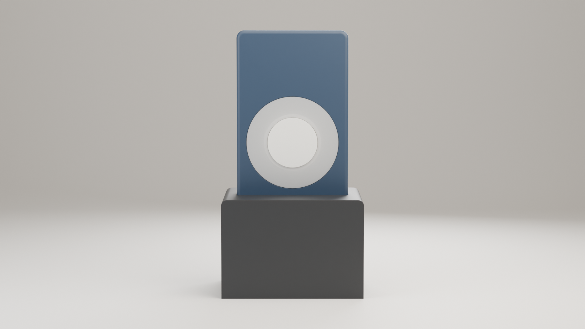
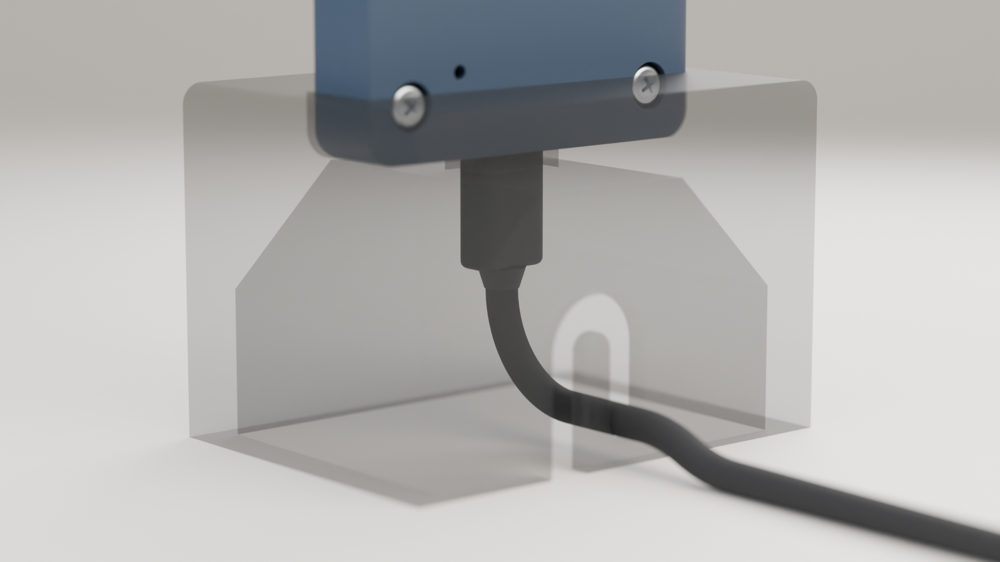

# Bell Aid: Bedienungsanleitung

**Ein Licht, das blinkt, wenn es an der Tür klingelt**

Version 1.2, 7. November 2026, Makehare

---

## 1. Was Bell Aid macht

Der **Sender** steht in der Nähe Ihres Türgongs und hört auf dessen Klang. Erkennt er die Klingel, blinkt der Lichtring jedes gekoppelten **Empfängers** in Ihrer Wohnung. Kein WLAN, keine App, keine Cloud: Der Klang wird direkt im Sender gelernt und erkannt. Sender und Empfänger sehen gleich aus; ein Sender versorgt bis zu 5 Empfänger.

{: style="max-height:34mm"}

*Lichtring mit Taste in der Mitte; eine Leuchte des Rings ist die Statusleuchte D1. Rendering des CAD-Modells, kein Foto; Farben können abweichen.*

## 2. Was Sie brauchen

- Den fertig gebauten Sender und einen oder mehrere Empfänger, jeweils im Standfuß (siehe Bauanleitung)
- Pro Gerät: ein USB-C-Kabel und ein USB-Netzteil, **5 V, mindestens 1,5 A**

## 3. Die Taste

Die Taste reagiert beim **Loslassen**. Während Sie sie gedrückt halten, leuchtet D1 nach 1,5 s **gelb** und nach 5 s **magenta**. So wissen Sie, wann Sie loslassen.

| Drücken | Sender | Empfänger |
|---|---|---|
| Kurz (< 1,5 s) | Testklingeln senden (Sender blinkt 3 s mit); beim Blinken: Blinken beenden | Stumm an/aus; beim Blinken: Blinken beenden |
| Lang (bei Gelb loslassen) | Anlernen starten | Eigenes Licht testen (3 s) |
| Sehr lang (bei Magenta loslassen) | Koppeln (30 s) | Koppeln (60 s) |

> [!TIP]
> Halten Sie beim Drücken den Standfuß fest, sonst kippt das Gerät um.

## 4. Einrichten

**1. Einstecken.** Heben Sie das Gerät aus dem Standfuß und stecken Sie das Kabel ein, während Sie das Gerät in der Hand halten. Setzen Sie es dann in den Standfuß, hängen Sie das Kabel in den J-Schlitz in der Rückwand ein und führen Sie es nach unten und hinten weg. Zum Ausstecken: Kabel aushängen, Gerät herausheben, dann den Stecker ziehen.

{: style="max-height:30mm"}

*Rückansicht, Standfuß durchsichtig dargestellt: Kabel eingesteckt und in den Schlitz eingehängt. Rendering des CAD-Modells, kein Foto.*

**2. Sender festlegen.** Jedes Gerät startet als Empfänger. So machen Sie ein Gerät zum Sender: Gerät in der Hand halten (außerhalb des Standfußes, wie in Schritt 1), Taste gedrückt halten, Kabel einstecken und weitere 5 s halten. D1 leuchtet gelb, blinkt dann 3-mal grün, und das Gerät startet als Sender neu. Auf demselben Weg wird es wieder zum Empfänger.

**3. Jeden Empfänger koppeln.**

1. Empfänger einstecken. Ein neuer Empfänger wartet 60 s auf die Kopplung (D1 blinkt schnell blau). Sonst seine Taste sehr lang drücken (Magenta).
2. Taste am Sender sehr lang drücken und bei Magenta loslassen. D1 blinkt 30 s lang magenta.
3. Der Empfänger blinkt 3-mal grün: gekoppelt. Für jeden Empfänger wiederholen.

**4. Sender aufstellen:** in der Nähe des Türgongs, dort, wo er bleiben soll. Das kleine Mikrofonloch auf der Rückseite frei lassen.

**5. Klingel anlernen.** Dabei sollte es im Raum ruhig sein.

1. Taste am Sender drücken und bei Gelb loslassen. D1 pulsiert blau: Der Sender wartet.
2. Klingeln und den Gong ganz ausklingen lassen. D1 leuchtet beim Zuhören türkis und blinkt dann grün.
3. Etwa 3 s warten und erneut klingeln, insgesamt 3-mal.
4. D1 blinkt 3-mal grün: gespeichert. 3-mal rot: kein Klingeln gehört, bitte neu beginnen.
5. **Prüfen:** einige Sekunden warten und noch einmal klingeln. Der ganze Ring des Senders und die Empfänger müssen blinken. Falls nicht, erneut anlernen.

> [!NOTE]
> Bei einer sehr kurzen Klingel (ein einzelnes „Ding“) kann das Klicken des Klingelknopfs mitgelernt werden. Schlägt die Prüfung immer wieder fehl: Lassen Sie jemand anderen bei geschlossener Tür klingeln, während Sie beim Sender bleiben, und lernen Sie neu an.

## 5. Im Alltag

Klingelt es, blinken Sender und jeder Empfänger 15 s lang mit dem ganzen Ring (Test: 3 s): weiß, dann sechs orange Lichter im Uhrzeigersinn. Ein kurzer Druck beendet es nur an diesem Gerät. Ein stumm geschalteter Empfänger zeigt nur Testklingeln an, bis Sie ihn wieder lautschalten oder ausstecken.

| Statusleuchte D1 | Sender | Empfänger |
|---|---|---|
| Alle 3 s kurz grün | Bereit | Bereit (gekoppelt) |
| Orange | Noch keine Klingel gelernt | Nicht gekoppelt |
| Ganzer Ring blinkt | Klingel erkannt oder Test gesendet | Klingel erkannt |
| Dauerhaft schwach rot | | Stumm |
| Magenta / schnell blau blinkend | Koppeln | Wartet auf Kopplung |
| Blau pulsierend, türkis, grünes Blinken | Anlernen: wartet, hört zu, Klingeln erfasst | |
| 3-mal grün / 3-mal rot | Anlernen gespeichert / fehlgeschlagen | Gekoppelt |

## 6. Schnelle Hilfe

| Problem | Lösung |
|---|---|
| Kein Licht | Netzteil prüfen (5 V, 1,5 A), anderes Kabel versuchen. |
| Orange Leuchte | Empfänger: koppeln (4, Schritt 3). Sender: anlernen (4, Schritt 5). |
| Test kommt nicht an | Empfänger neu koppeln; näher am Sender testen (Wände kosten Reichweite). |
| Klingel nicht erkannt | Am Standort neu anlernen, Mikrofonloch frei lassen. Kurze Klingel: Hinweis in 4. |
| Blinkt ohne Klingeln | In ruhigem Raum mit 3-mal Klingeln neu anlernen. |

## 7. Sicherheit, Funkdaten und Entsorgung

**Verwendung:** nur als optisches Türklingelsignal im Haushalt. **Open-Source-Selbstbauprojekt:** Bau und Nutzung auf eigene Gefahr; es ist kein zertifiziertes Produkt.

- Nur in trockenen Innenräumen; fern von Wasser, Hitze und direkter Sonne.
- **Kein Rauch- oder Brandmelder** und kein Ersatz dafür; nicht verwenden, wo ein verpasstes Signal gefährlich wäre.
- Kein Spielzeug, nicht für kleine Kinder. Vor dem Öffnen des Gehäuses und bei Schäden ausstecken.

| Technische Daten | |
|---|---|
| Frequenzband | 2,4 GHz (2400–2483,5 MHz) |
| Max. Sendeleistung | 20 dBm (100 mW) leitungsgebunden, Einstellung des ESP32-S3 |
| Stromversorgung | 5 V DC über USB-C, empfohlen mindestens 1,5 A |
| Hilfe und Fehlermeldungen | Makehare, request@makehare.com |
| Open-Source-Dateien | https://github.com/Makehare/bell-aid |

{: style="float:left; height:9mm; margin:0.5mm 3mm 0 0"}
**Entsorgung:** Die durchgestrichene Mülltonne bedeutet: nicht in den Hausmüll; geben Sie das Gerät bei einer Sammelstelle für Elektrogeräte ab (z. B. Wertstoffhof).

**Vor der Abgabe:** Das Gerät speichert keine personenbezogenen Daten, nur Rolle, Kopplungsdaten und gelernten Klingelton. Zum Löschen spielen Sie das vollständige Firmware-Image noch einmal auf (Bauanleitung, Abschnitt 6.2).
