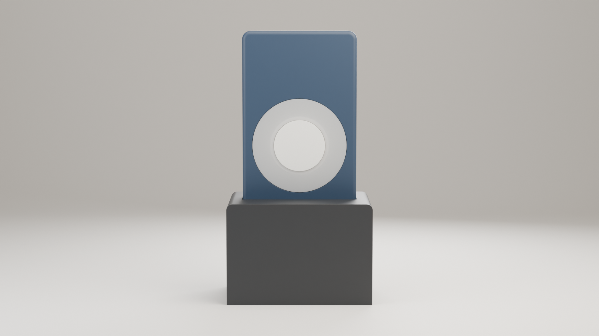
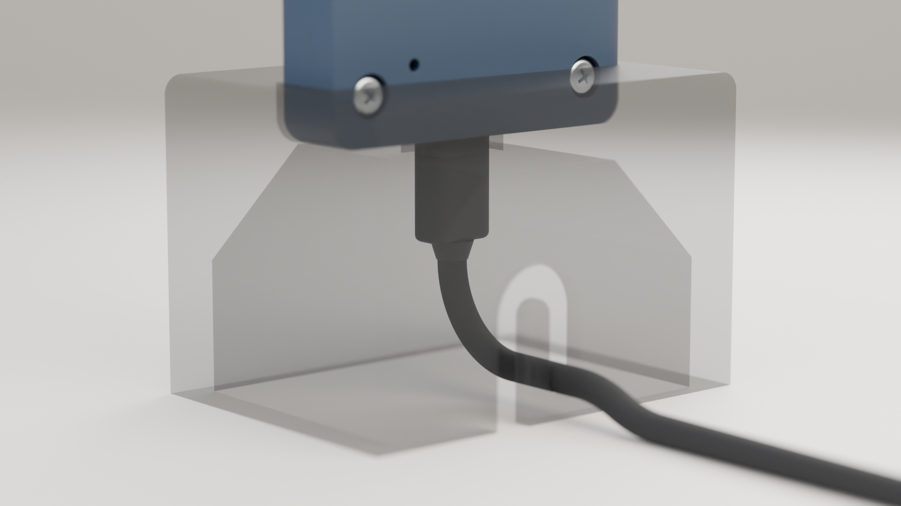

# Bell Aid: user manual

**A light that flashes when your doorbell rings**

Version 1.2, 2 November 2026, Makehare

---

## 1. What it does

The **sender** stands near your doorbell and listens for its sound. When it hears the bell, every paired **receiver** in your home flashes its light ring. No Wi-Fi, no app, no cloud: the sound is learned and recognised on the sender itself. Sender and receiver look the same; one sender works with up to 5 receivers.

{: style="max-height:34mm"}

*Light ring with the button in the centre; one light of the ring is the status light D1. Rendering of the CAD model, not a photograph; colours may differ.*

## 2. What you need

- The assembled sender and one or more receivers, each in its stand (see the build guide)
- Per unit: one USB-C cable and one USB wall plug, **5 V, at least 1.5 A**

## 3. The button

The button acts when you **release** it. While you hold it, the status light D1 turns **yellow** at 1.5 s and **magenta** at 5 s, so you know when to let go.

| Press | Sender | Receiver |
|---|---|---|
| Short (< 1.5 s) | Send a test ring | Mute on/off; while flashing: stop the flash |
| Long (release on yellow) | Start training | Test its own light (3 s) |
| Very long (release on magenta) | Pairing (30 s) | Pairing (60 s) |

> [!TIP]
> Hold the stand with one hand while you press the button; the light stand tips over easily.

## 4. Set up

**1. Plug in.** Lift the unit out of its stand and plug the cable in while you hold the unit in your hand. Then lower it into the stand, hook the cable into the J slot in the back wall and lead it down and to the rear. To unplug: unhook the cable, lift the unit out, then pull the plug.

{: style="max-height:30mm"}

*Back view, stand shown see-through: cable plugged in and hooked into the slot. Rendering of the CAD model, not a photograph.*

**2. Choose the sender.** Every unit starts as a receiver. To make one unit the sender: with the unit in your hand (out of its stand, as in step 1), hold its button while you plug in the cable and keep holding for 5 s. D1 turns yellow, then blinks green 3 times, and the unit restarts as the sender. The same gesture switches it back.

**3. Pair each receiver.**

1. Plug in the receiver. A new receiver waits for pairing for 60 s (D1 blinks fast blue). Otherwise hold its button very long (magenta).
2. Hold the sender's button very long and release on magenta. D1 blinks magenta for 30 s.
3. The receiver blinks green 3 times: paired. Repeat for each receiver.

**4. Place the sender** near the doorbell chime, where it will stay. Keep the small microphone hole on the back free.

**5. Teach it your doorbell.** Keep the room quiet.

1. Hold the sender's button and release on yellow. D1 pulses blue: waiting.
2. Ring the doorbell and let it play to the end. D1 is cyan while it listens, then flashes green.
3. Wait about 3 s and ring again; 3 rings in total.
4. D1 blinks green 3 times: saved. Red 3 times: no ring heard, start again.
5. **Check:** wait a few seconds and ring once more. D1 must flash white and the receivers must light up. If they do not, train again.

> [!NOTE]
> With a very short bell (a single "ding"), the click of the bell push can be learned with it. If the check keeps failing, have someone else press the push with the door closed while you stay at the sender, and train again.

## 5. Everyday use

When the bell rings, each receiver flashes for 15 s (test: 3 s); a short press stops it. A muted receiver shows only test rings until you unmute or unplug it.

| Status light D1 | Sender | Receiver |
|---|---|---|
| Green blip every 3 s | Ready | Ready (paired) |
| Orange | No doorbell learned yet | Not paired |
| White flash | Bell heard or test sent | (whole ring flashes) |
| Dim red, steady | | Muted |
| Magenta / fast blue blink | Pairing | Waiting for pairing |
| Blue pulse, cyan, green flash | Training: waiting, listening, ring captured | |
| Green 3x / red 3x | Training saved / failed | Paired |

## 6. Quick fixes

| Problem | What to do |
|---|---|
| No light at all | Check the wall plug (5 V, 1.5 A) and try another cable. |
| Orange light | Receiver: pair it (4, step 3). Sender: train it (4, step 5). |
| Test not received | Pair the receiver again; test it closer to the sender (walls cut range). |
| Bell not detected | Train again in place; keep the microphone hole free. Short bell: note in 4. |
| False alarms | Train again with 3 rings in a quiet room. |

## 7. Safety, radio data and disposal

**Intended use:** only as a visual doorbell signal in the home. **DIY open-source project:** you build and use it at your own risk; it is not a certified product.

- Indoors and in dry rooms only. Keep away from water, heat and direct sun.
- **Not a smoke or fire alarm** and no substitute; do not use where a missed signal is dangerous.
- Not a toy; keep away from small children. Unplug it before you open the case or if it is damaged.

| Technical data | |
|---|---|
| Frequency band | 2.4 GHz (2400–2483.5 MHz) |
| Max. RF power | 20 dBm (100 mW) conducted, ESP32-S3 setting |
| Power supply | 5 V DC via USB-C, at least 1.5 A recommended |
| Help and issues | Makehare, request@makehare.com |
| Open-source files | https://github.com/Makehare/bell-aid |

{: style="float:left; height:9mm; margin:0.5mm 3mm 0 0"}
**Disposal:** the crossed-out wheeled bin means: do not put it in household waste; take it to an electronics collection point (e.g. your recycling centre).

**Before you hand it in:** the unit stores no personal data, only its role, pairing data and the learned doorbell sound. To erase these, flash the complete firmware image once more (build guide, section 6.2).
